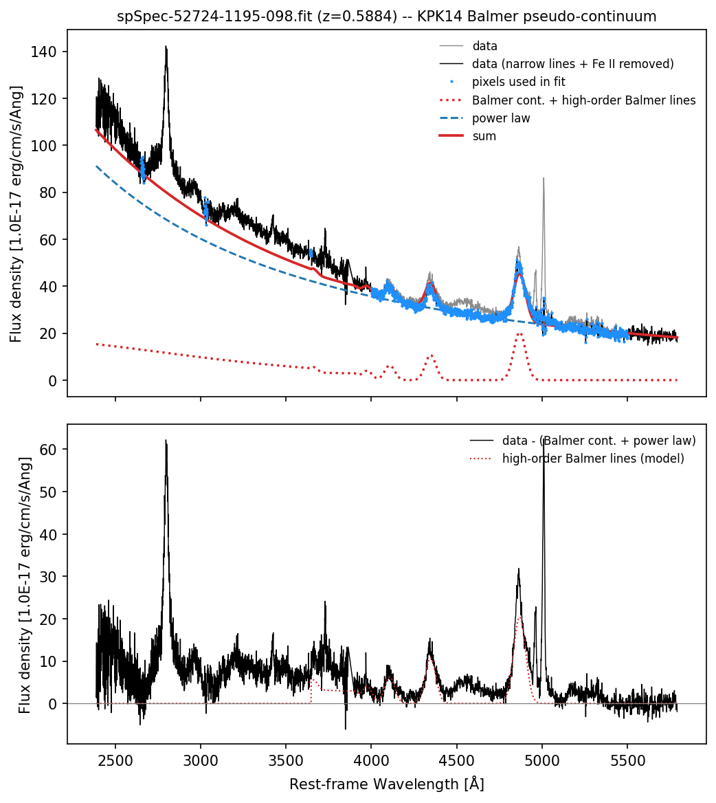

# agnspec

Python tools for fitting the optical and UV spectra of active galactic nuclei (AGN). The package is built around spectral components: a continuum made from a power law, Fe II, a Balmer pseudo-continuum and host-galaxy templates, plus emission-line complexes such as H-beta + [OIII] or Mg II. Components can be fitted with least squares, MCMC ([emcee](https://emcee.readthedocs.io)) or nested sampling ([dynesty](https://dynesty.readthedocs.io)).

Author: Ashwani Pandey  
Version: 1.0.1  
License: MIT

## What is in the package

| Module | Contents |
|---|---|
| `io` | `read_spectrum` (SDSS DR7 `spSpec`, SDSS DR8+ `spec`, generic FITS, ASCII, CSV), `save_results`, `load_results` |
| `preprocessing` | `to_rest_frame`, `deredden_spectrum`, `mask_bad_pixels`, `smooth_spectrum` |
| `continuum` | `PowerLaw`, `HostGalaxy`, `FeII`, `ContinuumModel`, `get_continuum_mask` |
| `balmer` | `BalmerPseudoContinuum`: high-order Balmer lines plus partially thick Balmer continuum (Kovačević et al. 2014) |
| `optical_region` | `OpticalRegionModel`: fits Fe II, narrow lines, He II and broad Balmer lines in 4000-5500 A; `load_park2022_feii` |
| `emission_lines` | `HbetaComplex`, `HalphaComplex`, `MgIIComplex`, `CIVComplex`, `OIIIComplex`, `extract_region` |
| `fitting` | `LeastSquares`, `MCMC`, `NestedSampling`, `FitResult` |
| `measurements` | `equivalent_width`, `line_flux`, `fwhm`, `sigma_velocity`, `velocity_shift`, `line_luminosity`, `virial_blackhole_mass`, `eddington_ratio`, `bolometric_luminosity` |
| `uncertainties` | `bootstrap_errors`, `residual_bootstrap_errors`, `credible_interval`, `propagate_errors` |
| `plotting` | `plot_spectrum`, `plot_continuum_windows`, `plot_continuum_fit`, `plot_line_fit`, `plot_balmer_fit` |
| `models` | `AGNModel`: continuum + line complexes + a fitter in one object |
| `pipeline` | `run_pipeline`: read, correct, fit one line complex, measure, save |
| `utils` | constants, `LINE_WAVELENGTHS` (vacuum), `get_ebv` (IRSA dust query), `air_to_vac` |

Every continuum component and line complex has the same four members (`model`, `initial_guess`, `bounds`, `param_names` or `free_param_names`), so any fitter works on any of them, and on sums of them.

Repository layout:

```
agnspec/
├── agnspec/            the package
│   └── data/           Fe II templates
├── examples/           notebooks, an SDSS spectrum, saved results
├── LICENSE
├── CHANGELOG.md
├── pyproject.toml
└── README.md
```

## Installation

Python 3.9 or newer. The core dependencies are numpy, scipy, matplotlib, astropy and requests.

```bash
git clone https://github.com/<your-username>/agnspec.git
cd agnspec
pip install .
```

Use `pip install -e .` instead if you want to edit the code. Optional extras:

```bash
pip install ".[mcmc]"       # emcee, needed for fitting.MCMC
pip install ".[nested]"     # dynesty, needed for fitting.NestedSampling
pip install ".[extinction]" # extinction package: Fitzpatrick99, O'Donnell94, Calzetti00 laws
pip install ".[pyneb]"      # pyneb, for the Storey & Hummer Balmer line ratios
pip install ".[examples]"   # jupyter and extinction (to run the notebook)
pip install ".[all]"        # everything above
```

Without the `extinction` package only the CCM89 law is available (a built-in version is used). `utils.get_ebv` needs an internet connection.

## Quick start

One line complex, start to finish:

```python
from agnspec.pipeline import run_pipeline

model, results = run_pipeline(
    filename="spSpec-52724-1195-098.fit",
    z=0.588403,
    ebv=0.0406,
    line="Hbeta",
    output_dir="agnspec_output",
)
print(results["line_measurements"]["oiii_5007"]["fwhm"])
```

The same thing step by step, with a power-law continuum and the H-beta complex:

```python
from agnspec import io, preprocessing as prep
from agnspec.continuum import PowerLaw
from agnspec.emission_lines import extract_region
from agnspec.fitting import LeastSquares
from agnspec.models import AGNModel

wave, flux, err, hdr = io.read_spectrum("spSpec-52724-1195-098.fit")
good = prep.mask_bad_pixels(wave, flux, err)
wave, flux, err = wave[good], flux[good], err[good]

flux, err = prep.deredden_spectrum(wave, flux, error=err, ebv=0.0406)  # observed frame
wave = prep.to_rest_frame(wave, z=hdr["Z"])                            # wavelength only

model = AGNModel(continuum_components=[PowerLaw(wave0=5100.0)], fitter=LeastSquares())
model.add_line_complex("Hbeta")

model.fit_continuum(wave, flux, error=err, continuum_windows=[(4200, 4230), (5080, 5130)])
line_flux = flux - model.continuum_flux(wave)

w, f = extract_region(wave, line_flux, 4750, 5100)
_, e = extract_region(wave, err, 4750, 5100)
model.fit_line("Hbeta", w, f, e)

for name, m in model.measure_line("Hbeta").items():
    print(name, m["flux"], m["fwhm"])
```

To sample the posterior instead, swap the fitter before fitting the line:

```python
from agnspec.fitting import MCMC

model.fitter = MCMC(n_walkers=32, n_steps=3000, n_burn=500, seed=1)
model.fit_line("Hbeta", w, f, e)
samples = model.line_results["Hbeta"].samples
```

These two snippets show the interface. A single Gaussian per line is too simple for most real H-beta profiles, so do not treat their numbers as a finished measurement. The notebooks below do it more carefully.

## Examples

The `examples` folder has an SDSS DR7 spectrum (SDSS J092423.42+064250.6, z = 0.588) and one notebook. Run it from inside `examples`; figures and arrays are written to `examples/results`.

* `01_balmer_continuum.ipynb`: dereddening, cleaning the broad Balmer profiles (power law + Fe II + narrow lines), then the power law + Balmer pseudo-continuum fit after Kovačević et al. (2014), with integrated fluxes and a comparison with the paper.



Examples for MCMC fitting and UV Fe II are planned for a future release. The `MCMC` and `NestedSampling` fitters are already available (see the quick start).

## Things to know

* **Vacuum wavelengths.** `LINE_WAVELENGTHS` holds vacuum values because SDSS spectra are in vacuum. The optical lines were converted from the usual air values (H-beta is 4862.69 A, not 4861.33 A).
* **Rest frame.** `to_rest_frame` shifts the wavelength axis only; flux density and errors are not rescaled. Integrals over rest wavelength are therefore smaller than the observed-frame ones by a factor 1 + z.
* **Balmer line ratios.** The Storey & Hummer (1995) table is not bundled. `BalmerPseudoContinuum` uses a built-in approximation unless you pass a real table (`table=`, `balmer.load_ratio_table`, or `balmer.pyneb_ratio_table`). The height of the Balmer edge depends on it, so use the real table for published numbers.
* **Fe II template.** `FeII` broadens the template with a kernel of fixed width in Angstrom and assumes an evenly spaced grid. For a template that spans a wide range (such as the 1075-7484 A one), crop it to the region you fit and resample it to an even grid first.
* **Fits can be degenerate.** In notebook 1, the simultaneous 4000-5500 A fit (several Gaussians, Fe II, He II) has parameters at their bounds and more than one minimum. Two scipy versions (1.17.1 and 1.18.1) gave different solutions for identical input, with chi-square/dof of 1.23 and 1.20 and a change of about 4 per cent in the final Balmer-continuum numbers. Check the fits and the bounds for your own spectra, and keep the library versions fixed when you need reproducible numbers.
* **Errors.** MCMC intervals assume the input errors are right, and the continuum uncertainty is not propagated into the line parameters.
* **Tested** with Python 3.12 (numpy 2.4, scipy 1.17, astropy 8.0, emcee 3.1). There is no automated test suite yet.

## Data and references

* `agnspec/data/irontemplate_park2022.dat`: optical Fe II template of Park, Barth, Ho & Laor (2022, ApJS), covering 4000-5600 A.
* `agnspec/data/irontemplate_boroson1992.ipac`: Fe II template covering 1075-7484 A, not used by the current example.
* Kovačević, J., Popović, L. Č., & Kollatschny, W. 2014, Advances in Space Research, 54, 1347 (Balmer pseudo-continuum).
* Greene & Ho 2005, ApJ, 630, 122 (continuum windows used in the examples).
* Vestergaard & Peterson 2006, ApJ, 641, 689 (black-hole mass); Richards et al. 2006, ApJS, 166, 470 (bolometric correction).
* Schlafly & Finkbeiner 2011 and Schlegel, Finkbeiner & Davis 1998 (dust maps behind `get_ebv`).
* Storey & Hummer 1995, MNRAS, 272, 41 (hydrogen line emissivities).

If you use agnspec in a publication, please cite this repository and the papers above that apply to the parts you used.
